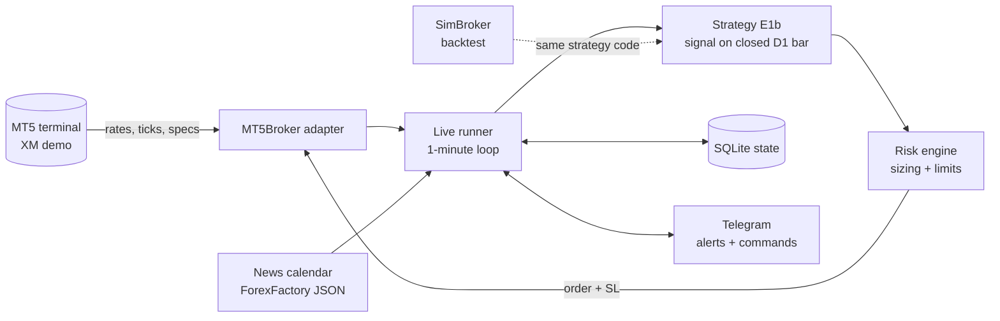

# MT5 Algorithmic Trading System (Python)

An automated trading system for **MetaTrader 5**, written in Python. It focuses on strict risk control, honest backtesting and reliable unattended operation.
The system runs on a Windows VPS and trades a **demo account** (XM, MT5). Monitoring and control happen through Telegram.

> **This is an engineering and research project, not a money-making claim.**
> Out of 15+ pre-registered strategy experiments, exactly one survived realistic costs, and its edge is small.
> The repository shows the full process, failures included.

---

## What it does

- **Live trading bot** (`bot/live/runner.py`): trades a daily (D1) index mean-reversion strategy on US500 and GER40. Every minute it checks the account, risk limits, news calendar and spreads, then acts on newly closed candles.
- **Backtest engine** (`bot/backtest/engine.py`): simulates spread, slippage, swap and the broker's real contract specs (min lot, lot step, tick value).
- **Research framework**: pre-registered experiments with in-sample / validation / out-of-sample splits and robustness checks.
- **Risk engine** (`bot/risk/sizing.py`): position sizing from stop distance, plus daily-loss and max-drawdown kill-switches.
- **Telegram control**: `/status`, `/pause`, `/resume`, `/stop`, `/news`, and `/check EURUSD BUY`, a rule-based pre-trade checklist.
- **News filter** (`bot/news.py`): blocks new entries within ±30 min of high-impact events (NFP, CPI, rate decisions). Exits are never blocked.

## Architecture



The strategy and risk code are shared between the backtest and live modes. The live runner was validated by replaying 2024–2026 data day by day: it reproduced the backtest's trades (26 of 27 matched; the one difference came from the daily loss limit firing as designed).

## Risk rules

| Rule | Value |
|---|---|
| Risk per trade | ≤ 1% of equity (stop-loss always sent with the order) |
| Daily loss limit | −2% → no new trades until next day |
| Max drawdown | −10% → kill-switch, all trading stops |
| Live account guard | `allow_live: false`. The bot refuses to run on a real-money account |
| Spread guard | No entry if spread > 2× normal |
| News guard | No new entry ±30 min around high-impact events |

## Research results

Method: every experiment's rules and pass criteria were written down **before** looking at results.
Data: in-sample 2010–2019, validation 2020–2023. The 2024–2026 out-of-sample period was used **once**, for the final candidate only.
Pass criteria: positive net expectancy and profit factor > 1.2 in both in-sample and validation, after XM's real costs.

| Strategy family | Markets | Result (net of costs) |
|---|---|---|
| H1 trend + pullback (EMA / Fibonacci) | EURUSD, GBPUSD, USDJPY | −0.19R per trade. No edge |
| H4 Donchian breakout | 3 FX pairs | −0.01R. Small gross edge eaten by costs |
| D1 trend-following (6 variants) | 18 instruments | Validation negative for all |
| FX D1 reversal, London breakout, Asian fade, BB mean reversion | FX majors | Negative |
| Turn-of-month, Double 7, time-series and cross-sectional momentum | Indices / 18 instruments | Failed in-sample or validation |
| **E1b: index RSI(2) < 5 mean reversion** | US500, US30, GER40, JP225 | **Passed** (below) |

**E1b rules:** daily bars, long only. Enter when RSI(2) < 5 and close > SMA(200). Exit when close > SMA(5) or after 10 days. Stop-loss at 3 × ATR.

| Period | Expectancy | Profit factor | Trades |
|---|---|---|---|
| In-sample 2010–2019 | +0.069R | 1.40 | 155 |
| Validation 2020–2023 | +0.042R | 1.21 | 71 |
| Out-of-sample 2024–2026 | +0.19R | 3.4 | 55 |

**Caveats:** the edge is small. At 0.5% risk it is roughly 1–2% per year. It loses money in correction years (2018, 2020, 2022). Only 25% of neighbouring parameter sets reach PF > 1.2. A 3-month demo forward test started in October 2026.

Raw research reports (in Mongolian) are in `reports/`.

## Project structure

```
bot/
  broker/mt5_broker.py     MT5 adapter (connection, specs, orders, retries)
  live/runner.py           live trading loop, reconciliation, kill-switch
  live/state.py            SQLite state (survives restarts)
  live/notifier.py         Telegram alerts
  strategy/                E1b and all tested strategies
  backtest/engine.py       cost-aware backtest engine
  backtest/metrics.py      win rate, PF, drawdown, Sharpe, Monte Carlo
  research/                diagnostics and statistics
  risk/sizing.py           lot calculation from risk % and stop distance
  news.py                  economic calendar filter
  tradecheck.py            /check pre-trade checklist (score 0-100)
scripts/                   run_live, backtests, research batches, data download
tests/                     67 unit tests (fake broker, synthetic data, look-ahead checks)
config/config.yaml         all settings (no secrets)
```

## Running it

Requires Windows, Python 3.11+ and an MT5 terminal logged in to a **demo** account.

```powershell
python -m venv .venv
.venv\Scripts\activate
pip install -r requirements.txt
copy .env.example .env        # then fill in your demo login and Telegram token
python -m pytest -q           # 67 tests
python scripts/check_connection.py
python scripts/run_live.py --once
```

Start with `live.dry_run: true` in `config/config.yaml`. In that mode the bot logs and reports what it would do, without sending orders.

## Tech

Python 3.11 · MetaTrader5 · pandas · NumPy · SQLite · Telegram Bot API · pytest · Windows Task Scheduler · Windows VPS

## Disclaimer

For educational and research purposes only. Not financial advice. Trading leveraged products carries a high risk of loss. Past or simulated results do not guarantee future performance.

## License

MIT, see [LICENSE](LICENSE).
